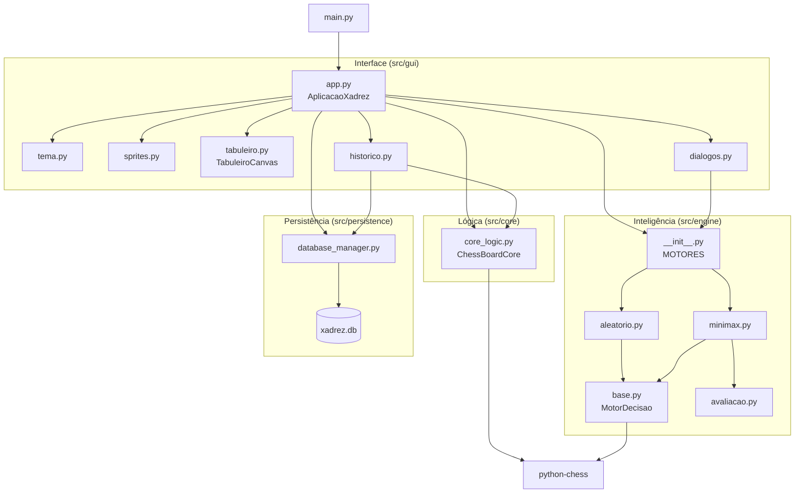
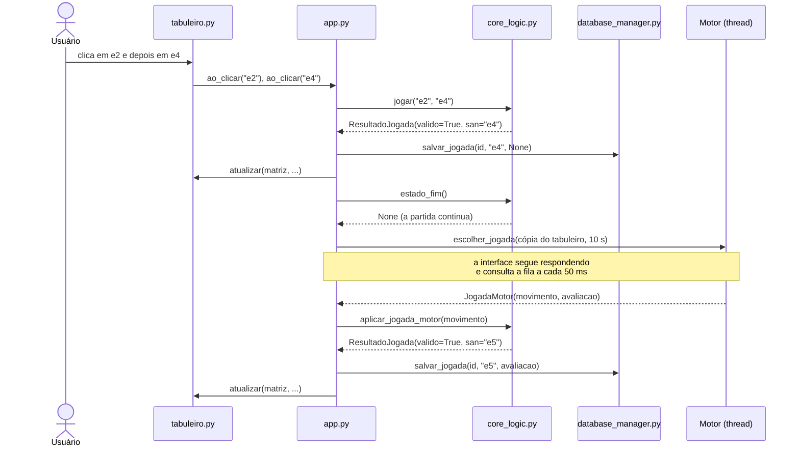

# Arquitetura

Como o código está organizado e como os módulos se comunicam.

---

## 1. Camadas

O sistema segue a arquitetura em camadas da documentação do projeto (seção 3.7). Cada camada tem uma responsabilidade e só depende das camadas abaixo dela.

| Camada | Pasta | Papel | O que faz no código |
| --- | --- | --- | --- |
| Interface | `src/gui/` | O tabuleiro físico e as mãos dos jogadores | Mostra a posição e captura cliques, arrastos e teclas |
| Lógica (Core) | `src/core/` | O árbitro | É o único que conhece as regras e o único que altera o tabuleiro oficial |
| Inteligência (Engine) | `src/engine/` | Um jogador (a IA) | Recebe uma cópia da posição e propõe um lance |
| Persistência | `src/persistence/` | A súmula, onde os lances são anotados | Grava partidas e lances no SQLite |

A dependência só aponta para um lado:

- A interface conhece o árbitro, o jogador-IA e a súmula, e coordena os três.
- O árbitro (core) não conhece a interface, a IA nem o banco. Ele só usa a biblioteca `python-chess`.
- A IA (engine) não conhece o árbitro, a interface nem o banco. Ela recebe um `chess.Board` e devolve um `chess.Move`.
- A súmula (persistence) não conhece nada de xadrez. Ela guarda textos (`"e4"`, `"Nf3"`) e números.

Assim, o motor de IA, a interface ou o banco podem ser trocados sem reescrever as outras partes. O Minimax, por exemplo, entrou ao lado do motor aleatório sem mudanças na interface.

---

## 2. Organização da pasta

```
IA-Xadrez/
├── main.py                       ponto de entrada da interface gráfica
├── requirements.txt              dependências (chess)
├── README.md                     como instalar, rodar e testar
├── .gitignore / .gitattributes   configuração do Git
│
├── src/
│   ├── core/
│   │   └── core_logic.py         ChessBoardCore: regras, validação, fim de jogo
│   ├── engine/
│   │   ├── base.py               contrato MotorDecisao + JogadaMotor, TEMPO_LIMITE_PADRAO
│   │   ├── aleatorio.py          MotorAleatorio (linha de base)
│   │   ├── avaliacao.py          funções de avaliação (material e tabelas de posição)
│   │   ├── minimax.py            Busca (Minimax/Alfa-Beta) + MotorMinimax e níveis
│   │   └── __init__.py           registro MOTORES (lista de motores da GUI)
│   ├── persistence/
│   │   ├── init_db.sql           esquema PARTIDA / JOGADA
│   │   ├── database_manager.py   funções de leitura e gravação
│   │   └── xadrez.db             banco gerado automaticamente (não versionado)
│   └── gui/
│       ├── app.py                janela principal + controlador da partida
│       ├── tabuleiro.py          widget do tabuleiro (desenho e entrada)
│       ├── dialogos.py           nova partida, promoção, atalhos
│       ├── historico.py          histórico e revisão de partidas
│       ├── tema.py               cores, fontes, estilos ttk
│       ├── sprites.py            carrega as imagens das peças
│       └── assets/pecas/         peças em PNG, 14 tamanhos
│
├── tests/
│   ├── test_core.py              regras do jogo
│   ├── test_persistencia_motor.py banco e registro de motores
│   ├── test_minimax.py           avaliação, Alfa-Beta, quiescência, aprofundamento iterativo
│   └── test_gui.py               integração com a interface
│
├── scripts/
│   ├── torneio.py                torneio entre motores (Stockfish como juiz)
│   ├── livro_aberturas.py        50 aberturas reais para o torneio (--livro)
│   └── gerar_sprites_pecas.py    gera assets/pecas (só desenvolvimento)
│
└── docs/                         documentação técnica (docs/resultados/, gerada pelo torneio, não é versionada)
```

---

## 3. Quem conversa com quem



As ligações internas da interface foram omitidas do diagrama: `tabuleiro.py`, `dialogos.py` e `historico.py` também usam `tema.py` e `sprites.py`, e `historico.py` reaproveita o `TabuleiroCanvas` na janela de revisão.

Dependências por módulo:

| Módulo | Importa | É importado por | Usa python-chess? | Usa Tkinter? |
| --- | --- | --- | --- | --- |
| `core/core_logic.py` | `chess` | `gui/app.py`, `gui/historico.py`, testes | Sim | Não |
| `engine/base.py` | `chess` | `engine/aleatorio.py`, `engine/minimax.py`, `engine/__init__.py` | Sim (tipos `Board` e `Move`) | Não |
| `engine/aleatorio.py` | `engine/base.py` | `engine/__init__.py` | Sim | Não |
| `engine/avaliacao.py` | `chess` | `engine/minimax.py`, testes | Sim | Não |
| `engine/minimax.py` | `engine/base.py`, `engine/avaliacao.py` | `engine/__init__.py`, testes | Sim | Não |
| `engine/__init__.py` | `aleatorio`, `minimax`, `base` | `gui/app.py`, `gui/dialogos.py`, `scripts/torneio.py`, testes | Não | Não |
| `persistence/database_manager.py` | `sqlite3` | `gui/app.py`, `gui/historico.py`, testes | Não | Não |
| `gui/app.py` | core, engine, persistence, módulos da GUI | `main.py`, `tests/test_gui.py` | Não | Sim |
| `gui/tabuleiro.py` | `tema`, `sprites` | `app.py`, `historico.py` | Não | Sim |

Nenhum arquivo da interface importa `chess`: ela trabalha só com coordenadas em texto (`"e2"`) e com os tipos simples que o core devolve, o que mantém as regras isoladas no core.

---

## 4. Comunicação entre as camadas

### 4.1 Interface → Core (`ChessBoardCore`)

A interface envia coordenadas algébricas e recebe tipos simples.

| Método | Recebe | Devolve | Usado para |
| --- | --- | --- | --- |
| `obter_matriz()` | nada | lista 8x8 de símbolos (`"P"`, `"k"`, `"."`) | Desenhar o tabuleiro |
| `vez()` | nada | `"brancas"` ou `"pretas"` | Saber de quem é a vez |
| `cor_em(casa)` | `"e2"` | cor da peça ou `None` | Decidir se a peça pode ser selecionada |
| `destinos_legais(casa)` | `"e2"` | `[("e3", False), ("e4", False)]` | Pontos e anéis de destino (o `bool` diz se é captura) |
| `exige_promocao(origem, destino)` | duas casas | `bool` | Abrir o diálogo de promoção |
| `jogar(origem, destino, promocao)` | casas e `"q"`/`"r"`/`"b"`/`"n"` | `ResultadoJogada` | Lance por mouse ou teclado |
| `jogar_texto(texto)` | `"Nf3"` ou `"e2e4"` | `ResultadoJogada` | Lance digitado |
| `estado_fim()` | nada | `FimDeJogo` ou `None` | Detectar mate, afogamento etc. |
| `casa_rei_em_xeque()`, `ultimo_lance()` | nada | casa(s) em texto | Destaques visuais |
| `lances_san()`, `capturas()`, `vantagem_material()` | nada | listas e números | Lista de lances e painel lateral |
| `desistir(cor)`, `reivindicar_empate()` | cor / nada | `FimDeJogo` | Botões da partida |
| `carregar_lances(lista)` | lista de SAN | `(aplicados, erro)` | Retomar ou revisar uma partida |

`ResultadoJogada` traz `valido`, `san` (ex.: `"Nf3"`), `origem`, `destino` e `mensagem`. Quando o lance é recusado, `mensagem` já explica o motivo ("Esse lance deixaria o rei das brancas em xeque.") e a interface só a exibe.

Exemplo de uso do core, a partir da raiz do projeto:

```python
from src.core.core_logic import ChessBoardCore

jogo = ChessBoardCore()
print(jogo.destinos_legais("g1"))     # [('h3', False), ('f3', False)]
print(jogo.jogar("e2", "e5"))         # valido=False, mensagem="Movimento ilegal: o peão..."
print(jogo.jogar("e2", "e4").san)     # e4
print(jogo.vez())                     # pretas
```

### 4.2 Interface → Engine (`MotorDecisao`)

Todo motor herda de `MotorDecisao`, definido em `engine/base.py`:

```python
class MotorDecisao(ABC):
    chave: str        # identificador: "aleatorio"
    nome: str         # texto mostrado na GUI e gravado em PARTIDA.dificuldade_ia
    descricao: str    # frase exibida no diálogo de nova partida

    def escolher_jogada(self, tabuleiro: chess.Board, tempo_limite: float) -> JogadaMotor: ...
```

- Entrada: uma cópia do tabuleiro (`ChessBoardCore.copia_tabuleiro()`), que o motor pode alterar sem afetar o tabuleiro oficial.
- Saída: `JogadaMotor(movimento, avaliacao, detalhes)`. A `avaliacao` vai para a coluna `JOGADA.avaliacao_ia`.
- O motor roda em uma thread separada, iniciada por `_agendar_ia` em `app.py`, e por isso não acessa widgets do Tkinter.
- O resultado volta por uma `queue.Queue`, que a interface consulta a cada 50 ms (`_verificar_ia`) enquanto mostra o tempo de reflexão.

### 4.3 Engine → Core (passando pela Interface)

O motor não conversa diretamente com o core. A interface recebe o `chess.Move` proposto e o entrega ao core com `aplicar_jogada_motor(movimento)`, que confere se o lance é legal antes de aplicá-lo. Um lance ilegal vindo do motor é recusado sem alterar o tabuleiro.

### 4.4 Interface → Persistência (`database_manager`)

| Função | Quando a interface chama |
| --- | --- |
| `criar_banco()` | Na abertura (cria as tabelas se não existirem) |
| `iniciar_nova_partida(dificuldade)` | Ao começar uma partida; devolve o id |
| `salvar_jogada(id, san, avaliacao)` | A cada lance, com commit imediato (RNF 7) |
| `finalizar_partida(id, resultado)` | No fim da partida ou ao abandoná-la |
| `buscar_partida_em_andamento()` | Na abertura, para oferecer a retomada |
| `listar_partidas()`, `obter_partida(id)`, `obter_jogadas(id)` | Na janela de histórico e na revisão |
| `atualizar_dificuldade(id, rotulo)` | Ao retomar uma partida com outra configuração |

O banco fica em `src/persistence/xadrez.db`. A variável de ambiente `XADREZ_DB` troca esse caminho; os testes usam um banco temporário dessa forma.

### 4.5 Dentro da Interface: tabuleiro ↔ controlador

`tabuleiro.py` não conhece as regras: desenha o que recebe e avisa o controlador por callbacks passados na criação do widget:

| Callback | Disparado quando | Implementado em `app.py` por |
| --- | --- | --- |
| `ao_clicar(casa)` | Clique, Enter ou Espaço sobre uma casa | `_ao_clicar_casa` |
| `ao_soltar(origem, destino)` | Uma peça arrastada é solta em outra casa | `_ao_soltar` |
| `pode_arrastar(casa)` | O mouse passa ou pressiona sobre uma peça | `_pode_mover` |
| `ao_cancelar()` | Tecla Esc | `_cancelar_selecao` |

No sentido contrário, o controlador chama `tabuleiro.atualizar(matriz, selecionada=..., destinos=..., ultimo=..., xeque=...)` para redesenhar.

---

## 5. Fluxo de um lance



Passo a passo no código:

1. O usuário clica numa peça. `TabuleiroCanvas._ao_pressionar` converte o pixel em casa (`casa_em`) e chama `ao_clicar("e2")`.
2. `AplicacaoXadrez._ao_clicar_casa` pergunta ao core de quem é a peça (`cor_em`) e marca a seleção. Os destinos vêm de `destinos_legais`.
3. No segundo clique, `_tentar_lance` chama `jogo.jogar(origem, destino)`. Se for promoção, antes abre `DialogoPromocao`.
4. Lance recusado: `_recusar` faz a casa piscar em vermelho e mostra `resultado.mensagem` no rodapé. O tabuleiro não muda.
5. Lance aceito: `_concluir_lance` grava no banco (`_salvar_lance`), redesenha a tela, verifica o fim de jogo e, se for a vez da IA, chama `_agendar_ia`.
6. `_agendar_ia` inicia a thread do motor e agenda `_verificar_ia`, que lê a fila sem travar a janela.
7. Quando a resposta chega, `aplicar_jogada_motor` valida o lance, e o fluxo segue pelo mesmo `_concluir_lance` do passo 5.

---

## 6. Ciclo de vida de uma partida no banco

| Momento | O que acontece | Coluna `PARTIDA.resultado` |
| --- | --- | --- |
| Nova partida | `iniciar_nova_partida` cria o registro | `Em andamento` |
| Cada lance | `salvar_jogada` grava uma linha em `JOGADA` | (sem mudança) |
| Fim normal | `finalizar_partida` grava o resultado | ex.: `Vitória das brancas (xeque-mate)` |
| Nova partida no meio de outra | A atual é encerrada | `Abandonada` |
| Janela fechada com lances | A partida fica aberta para retomada | `Em andamento` |
| Próxima abertura | `buscar_partida_em_andamento` oferece continuar; os lances são reaplicados com `carregar_lances` | `Em andamento` ou `Abandonada` |

---

## 7. Onde mexer para cada tipo de mudança

| Mudança | Arquivo | Onde |
| --- | --- | --- |
| Trocar a avaliação do Minimax | `src/engine/avaliacao.py` | Ver seção 8 |
| Criar um nível novo do Minimax | `src/engine/minimax.py` + `src/engine/__init__.py` | Ver seção 8 |
| Mudar uma mensagem de lance ilegal | `src/core/core_logic.py` | `explicar_ilegalidade`, `_explicar_roque` |
| Mudar uma regra de fim de jogo | `src/core/core_logic.py` | `estado_fim`, `motivo_empate_reivindicavel` |
| Mudar cores, fontes ou estilo de botões | `src/gui/tema.py` | constantes no topo e `aplicar_estilo` |
| Mudar o desenho do tabuleiro (destaques, coordenadas) | `src/gui/tabuleiro.py` | `_redesenhar`, `_cor_casa` |
| Mudar o painel lateral ou os botões | `src/gui/app.py` | `_montar_interface`, `CartaoJogador` |
| Adicionar um atalho de teclado | `src/gui/app.py` + `src/gui/dialogos.py` | `_registrar_atalhos` e a lista `ATALHOS` |
| Mudar o limite de 10 s da IA | `src/engine/base.py` | `TEMPO_LIMITE_PADRAO` (vale para a interface e o torneio) |
| Mudar o esquema do banco | `src/persistence/init_db.sql` + `database_manager.py` | atualizar também o DER da documentação |
| Trocar o desenho das peças | `scripts/gerar_sprites_pecas.py` | o script gera um novo `assets/pecas/` |

---

## 8. Motor Minimax

O motor fica dividido em duas peças independentes:

| Peça | Arquivo | Papel |
| --- | --- | --- |
| Busca | `src/engine/minimax.py` (`Busca`, `MotorMinimax`) | Monta a árvore de lances e escolhe o melhor |
| Avaliação | `src/engine/avaliacao.py` (`Avaliador`, `avaliar_material`, `avaliar_posicional`) | Dá nota a uma posição parada |

A busca recebe a avaliação como parâmetro (`MotorMinimax(avaliador=...)`). Melhorar a heurística ou usar uma avaliação treinada é trocar só essa função; a busca não muda.

### 8.1 Convenções

- Nota sempre na perspectiva das **brancas**, em peões: positivo = brancas melhor.
- Brancas são o jogador MAX (maximizam a nota); pretas são o MIN (minimizam).
- Mate vale `±(MATE - ply)`, com `MATE = 1000` e `ply` = distância até a raiz. Assim o motor prefere o mate mais rápido e adia o próprio.
- Afogamento, material insuficiente e regra dos 50 lances valem 0.
- Repetição: uma posição que já apareceu (na partida ou na linha da busca) vale 0. Quem está ganhando evita o vaivém e quem está perdendo procura a repetição. A raiz não conta, porque é a posição atual. Funciona porque `copia_tabuleiro()` mantém o histórico de lances.

### 8.2 Algoritmo

- `Busca.minimax`: Minimax puro, sem poda. Serve de referência nos testes e para explicar o conceito.
- `Busca.alfa_beta`: o mesmo Minimax com poda Alfa-Beta. `alfa` é o melhor que MAX já tem garantido, `beta` o melhor de MIN; quando `alfa >= beta` os lances restantes do nó são cortados. Os testes `TestAlfaBeta` e `TestQuiescencia` confirmam que as versões com e sem poda devolvem a mesma nota, com menos nós na versão podada. Com quiescência, a versão sem poda cresce exponencialmente em posições com muitas capturas, então esses testes usam posições com poucas trocas.
- `Busca.quiescencia`: chamada quando a profundidade acaba. Em vez de avaliar direto, continua só com capturas até a posição ficar "quieta". Isso evita o **efeito horizonte**: avaliar no meio de uma troca (ex.: "dama come peão" parece +1, mas o peão que retoma a dama fica além da profundidade).
  - **Stand pat:** fora de xeque, quem joga pode "ficar parado". A nota da posição como está já é uma opção, e uma captura só é escolhida se for melhor que ela.
  - **Em xeque** não existe essa opção: a quiescência olha todas as respostas ao xeque. Assim ela também enxerga um mate no fim de uma troca.
  - Não tem limite de profundidade: termina porque cada captura tira uma peça do tabuleiro.
  - `Busca.quiescencia_pura` é a mesma ideia sem poda, usada pelo `minimax` puro e como referência nos testes.
  - `Busca(quiescencia=False)` ou `MotorMinimax(quiescencia=False)` desliga a quiescência, para comparar.
- `Busca.ordenar`: capturas primeiro, em ordem **MVV-LVA** (vítima mais valiosa primeiro e, entre vítimas iguais, o atacante mais barato: `exd5` antes de `Qxd5`). Não muda o resultado; só faz a poda cortar mais cedo.
- `Busca.nos` conta os nós visitados; o motor mostra esse número em `JogadaMotor.detalhes`.
- **Aprofundamento iterativo** (`MotorMinimax.escolher_jogada`): o motor busca com profundidade 1, depois 2, 3... até a profundidade máxima do nível, e devolve o melhor lance da última rodada **completa**.
  - **Prazo:** a cada 1024 nós a busca olha o relógio (`Busca.contar_no`). Se passou de 90% do `tempo_limite`, ela é interrompida com a exceção `TempoEsgotado`, os lances que ficaram no tabuleiro são desfeitos e vale a rodada anterior. A profundidade 1 sempre termina, para sempre haver um lance.
  - **Rodada nova só com tempo:** se já gastou metade do tempo, não começa outra, porque a próxima costuma custar várias vezes a anterior.
  - **Ordem:** em cada rodada, o melhor lance da anterior é testado primeiro. Isso faz a poda cortar mais cedo, e na prática as rodadas menores quase se pagam: o difícil ficou mais rápido do que com profundidade fixa.
  - **Mate:** se a rodada de profundidade d achou um mate a até d meios-lances, a busca para, porque ir mais fundo não acha um mais curto.
  - **Por que importa para o treino:** uma avaliação aprendida será mais lenta que as tabelas. Com o prazo, o motor respeita o `tempo_limite` com qualquer avaliador e só alcança uma profundidade menor.
  - **Reprodutibilidade:** com 10 s, os níveis atuais terminam a profundidade máxima em praticamente toda posição. O tempo só age como rede de segurança, e os torneios dão sempre o mesmo resultado. Só uma posição que estourasse o prazo poderia variar de uma máquina para outra. `parou_por_tempo` marca quando isso acontece (parar mais cedo por ter achado mate não conta), e o torneio soma esses lances na coluna "Prof. incompleta": com 0, o resultado não dependeu da velocidade da máquina.

### 8.3 Avaliação

`avaliar_posicional` é a avaliação padrão do motor: material + **tabelas de posição** (piece-square tables, valores da "Simplified Evaluation Function" de Tomasz Michniewski). Cada peça ganha um bônus ou penalidade, em centésimos de peão, conforme a casa: cavalo e bispo no centro, peão avançado, torre na 7ª fileira e rei rocado valem mais. As tabelas estão escritas do ponto de vista das brancas (a8 primeiro); para as brancas a casa é espelhada com `chess.square_mirror`, e para as pretas o índice direto já é o espelho. A conta é feita em inteiros e dividida por 100 no fim, para a nota de uma posição e a da posição espelhada serem exatamente opostas.

Para ser rápida, `avaliar_posicional` não usa `piece_map()`, que cria um objeto por peça a cada chamada. Ela percorre os *bitboards* do python-chess (um inteiro de 64 bits por tipo e cor de peça) e soma valores já pré-calculados em `VALOR_CASA` (material + bônus, por cor, tipo e casa). O resultado é idêntico à soma peça a peça (conferido em 2000 posições aleatórias) e cerca de 30% mais rápido no motor, porque a avaliação é chamada dezenas de milhares de vezes por lance.

`avaliar_material` continua disponível (`MotorMinimax(avaliador=avaliar_material)`), útil para comparar as duas no TCC.

Sem as tabelas, todos os lances sem captura empatavam em 0 e o motor jogava sempre o primeiro da lista. O resultado era o vaivém de cavalo e torre (`Nh6`, `Ng8`, `Rg8`, `Rh8`...).

### 8.4 Níveis

O registro cria motores sem argumentos, então cada nível é uma subclasse que só muda a profundidade máxima:

| Classe | Chave | Profundidade máxima |
| --- | --- | --- |
| `MotorMinimaxFacil` | `minimax_facil` | 2 |
| `MotorMinimaxMedio` | `minimax_medio` | 3 |
| `MotorMinimaxDificil` | `minimax_dificil` | 4 |

Tempo por lance com quiescência e aprofundamento iterativo (Ryzen 5 7600):

| Posição | Fácil | Médio | Difícil |
| --- | --- | --- | --- |
| Inicial | 0,00 s | 0,01 s | 0,08 s |
| Meio-jogo calmo | 0,04 s | 0,55 s | 1,4 s |
| Meio-jogo com muitas trocas possíveis | 0,1 s | 0,9 s | 5,7 s |

A quiescência deixou o difícil bem mais lento (antes ficava em até ~1 s). Se uma posição passar do prazo, o aprofundamento iterativo garante a resposta dentro do limite, com a profundidade 3.

### 8.5 Limitações conhecidas (próximos passos)

- O rei usa só a tabela de meio-jogo: no final ele não procura o centro.
- Repetição em posição igual: a nota 0 da repetição faz o motor aceitar o vaivém quando acha que a posição está equilibrada. A solução usual é o *contempt* (empate levemente ruim para o lado mais forte).
- Sem tabela de transposição: posições iguais, alcançadas por ordens de lances diferentes, são analisadas de novo.

## 9. Regras de dependência

1. `src/core` e `src/engine` nunca importam `tkinter`.
2. `src/gui` nunca importa `chess`: tudo o que envolve regras passa pelo `ChessBoardCore`.
3. `src/engine` nunca importa `src/core`, `src/gui` ou `src/persistence`: recebe um tabuleiro e devolve um lance.
4. `src/persistence` não sabe nada de xadrez: só guarda texto e números.
5. Só a thread principal toca em widgets do Tkinter; o motor se comunica apenas pela fila.

Verificação das regras 1 a 3 (nenhum comando deve retornar resultado):

Linux:

```bash
grep -rn "tkinter" src/core src/engine src/persistence
grep -rn "^import chess\|^from chess" src/gui
grep -rn "from src" src/engine src/core src/persistence
```

Windows (PowerShell):

```powershell
Select-String -Path src\core\*.py, src\engine\*.py, src\persistence\*.py -Pattern "tkinter"
Select-String -Path src\gui\*.py -Pattern "^import chess|^from chess"
Select-String -Path src\engine\*.py, src\core\*.py, src\persistence\*.py -Pattern "from src"
```

---

## 10. Arquivos gerados automaticamente

| Arquivo | Quem gera | Versionado no Git? |
| --- | --- | --- |
| `src/persistence/xadrez.db` | `criar_banco()`, na abertura da GUI | Não (`.gitignore`) |
| `__pycache__/` | O próprio Python, ao importar os módulos | Não (`.gitignore`) |
| `.venv/` | `python -m venv .venv` | Não (`.gitignore`) |
| `src/gui/assets/pecas/` | `scripts/gerar_sprites_pecas.py` | Sim: a GUI depende dessas imagens |
